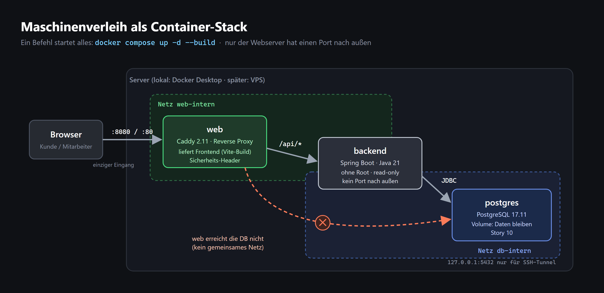

# Anleitung – Anwendung als Container-Stack (Datenbank, Backend, Webserver)

**Bezug:** [Issue #34](https://github.com/24it1schumacher/Abschlussprojekt_Berufsschule_Gruppe_8/issues/34) (mehrere Container über eine versionierte Konfiguration gemeinsam starten), Grundlage für [#8](https://github.com/24it1schumacher/Abschlussprojekt_Berufsschule_Gruppe_8/issues/8) (Reverse Proxy) und [#18](https://github.com/24it1schumacher/Abschlussprojekt_Berufsschule_Gruppe_8/issues/18) (TLS)
**Baut auf:** [PostgreSQL-Anleitung](anleitung_postgresql_vps.md) (Story 10)
**Dateien:** [`infra/stack/compose.yaml`](../infra/stack/compose.yaml), [`infra/proxy/Caddyfile`](../infra/proxy/Caddyfile), [`app/backend/Dockerfile`](../app/backend/Dockerfile), [`app/frontend/Dockerfile`](../app/frontend/Dockerfile)



---

## 1. Aufbau

| Container | Image | Aufgabe | Netze | Port nach außen |
|---|---|---|---|---|
| `web` | eigenes Image auf Basis `caddy:2.11-alpine` | liefert das gebaute Frontend aus, leitet `/api/*` an das Backend | `web-intern` | ja (lokal `127.0.0.1:8080`, VPS `80`) |
| `backend` | eigenes Image auf Basis `eclipse-temurin:21-jre-noble` | Spring-Boot-API | `web-intern`, `db-intern` | nein |
| `postgres` | `postgres:17.11-trixie` (aus Story 10, per `include`) | Datenbank | `db-intern` | nur `127.0.0.1:5432` für den SSH-Tunnel |

## 2. Entscheidungen

| Thema | Entscheidung | Begründung | Alternative |
|---|---|---|---|
| Webserver / Reverse Proxy | Caddy | Kurze, lesbare Konfiguration; holt TLS-Zertifikate später automatisch (#18) | nginx + certbot (mehr Konfiguration, Zertifikat separat), Traefik (Konfiguration über Container-Labels) |
| Ein Eingang | Frontend und `/api` unter derselben Adresse | Kein CORS nötig, Cookies und CSRF-Schutz funktionieren ohne Sonderregeln, nur ein offener Port | Frontend und API auf getrennten Ports (CORS, zwei offene Ports) |
| Netztrennung | Zwei Netze: `web-intern` und `db-intern` | Wird der Webserver kompromittiert, erreicht er die Datenbank trotzdem nicht | Ein gemeinsames Netz (einfacher, aber jeder Container erreicht jeden) |
| Images | Mehrstufige Builds (Build-Stufe + schlanke Laufzeit) | Kein Compiler, kein Maven, kein Node und kein Quellcode im laufenden Container | Ein Image mit allem (größer, mehr Angriffsfläche) |
| Tests | Laufen beim Bau des Backend-Images (`mvn package`) | Schlägt ein Test fehl, entsteht kein Image und es wird nichts ausgerollt | Tests nur in der IDE |
| Härtung | Backend als UID 1000, beide Container `read_only`, `no-new-privileges`, Log-Rotation, Sicherheits-Header | Weniger Schaden bei einer Lücke im Anwendungscode | — |
| Projektname | `maschinenverleih-db` wie in Story 10 | Der laufende Datenbank-Container wird übernommen und nicht ein zweites Mal auf demselben Volume gestartet | Eigener Projektname (Gefahr: zwei Datenbanken auf einem Volume) |

## 3. Voraussetzungen

- Datenbank nach der [PostgreSQL-Anleitung](anleitung_postgresql_vps.md) eingerichtet: `infra/postgres/.env`, Rolle `maschinenverleih_app`, Datenbank `maschinenverleih`, Schema 002–010.
- Docker mit Compose 2.20 oder neuer (wegen `include`).

## 4. Starten

```bash
cd infra/stack
cp .env.example .env
chmod 600 .env
nano .env          # APP_DB_PASSWORD = Passwort der Rolle maschinenverleih_app
docker compose up -d --build
docker compose ps  # backend und postgres "healthy", web "Up"
```

Danach im Browser `http://localhost:8080` öffnen (auf dem VPS: Server-Adresse, Port 80).

**Erstes Admin-Konto:** Für den allerersten Start `BOOTSTRAP_ADMIN_EMAIL` und `BOOTSTRAP_ADMIN_PASSWORD`
(mindestens 12 Zeichen) in `.env` setzen. Nach dem Start die beiden Werte wieder leeren und
`docker compose up -d` ausführen. Beim ersten Login verlangt die Anwendung ein neues Passwort.

**Auf dem VPS** zusätzlich in `.env`: `WEB_BIND=0.0.0.0:80` und `PUBLIC_ORIGIN=http://<server>`.
In ufw muss Port 80 erlaubt sein (`sudo ufw allow 80/tcp`). Ohne TLS ist das nur für Tests gedacht;
HTTPS folgt mit #18 (Domain in das Caddyfile eintragen, dann `COOKIE_SECURE=true`).

## 5. Nachweise (lokaler Probelauf 25.11.2026)

| Nachweis | Befehl | Ergebnis |
|---|---|---|
| Tests im Build | `docker compose build --no-cache backend` | `Tests run: 13, Failures: 0, Errors: 0` · `BUILD SUCCESS` |
| Stack läuft | `docker compose ps` | 3 Container; nur `web` veröffentlicht einen Port |
| Routing | `curl http://localhost:8080/api/health/database` | `{"status":"ok"}` über den Proxy |
| Sicherheits-Header | `curl -I http://localhost:8080/` | `X-Frame-Options: DENY`, `X-Content-Type-Options: nosniff`, kein `Server`-Header |
| Netztrennung | `docker compose exec web nc -zv -w 3 postgres 5432` | `bad address 'postgres'`: der Webserver kennt die Datenbank nicht |
| Kein Root | `docker compose exec backend id` | `uid=1000(ubuntu)` |
| Schreibschutz | `docker compose exec backend touch /app/test.txt` | `Read-only file system` |
| Anmeldung | Login im Browser über den Proxy | Session-Cookie und CSRF-Schutz funktionieren, Aufforderung zum Passwortwechsel erscheint |

Bilder dazu: [`docs/praesentation/app_stack/`](praesentation/app_stack/README.md).

## 6. Betrieb

| Aufgabe | Befehl |
|---|---|
| Neue Version bauen und ausrollen | `git pull && docker compose up -d --build` |
| Logs | `docker compose logs -f backend web` |
| Nur Webserver-Konfiguration neu laden | `docker compose restart web` |
| Stoppen (Daten bleiben) | `docker compose down` |

## 7. Grenzen und nächste Schritte

- Noch kein HTTPS: Caddy kann es automatisch, braucht aber eine Domain (#18).
- Die Images werden auf dem Server gebaut. Besser: Die Pipeline (#28) baut und prüft sie, der Server lädt nur fertige Images.
- Kein Backup und kein Monitoring der Anwendung (#26, #27).
- Der Webserver-Container hat keinen eigenen Healthcheck.
